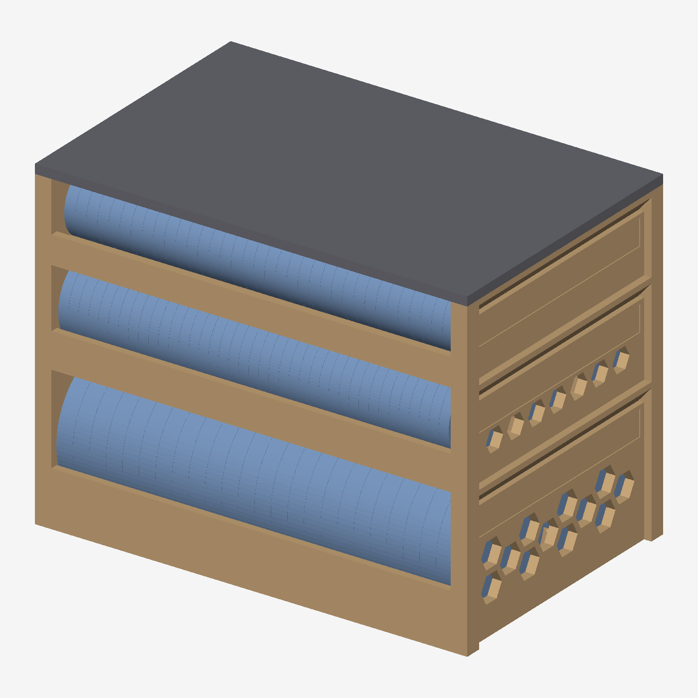

# Coin Vault

3D-printable storage trays for copper bullion in Air-Tite capsules. Coins stand on
edge, face to face, in a curved cradle, and a sliding bookend keeps a part-full row
upright. Everything is parametric OpenSCAD and prints with no supports.



## Parts

| File | Holds | Size (mm) | PLA |
|---|---|---|---|
| `coin_vault_tray_Y63.stl` | 48 × 5 oz rounds in Air-Tite **Y63** (Ø71.37 × 8.9) | 233 × 151 × 78 | ~210 g |
| `coin_vault_tray_H39.stl` | 117 × 1 oz rounds in Air-Tite **H39** (Ø44.45 × 5.4) | 233 × 151 × 51 | ~175 g |
| `coin_vault_tray_NICKEL.stl` | 175 × Buffalo nickels in Ø25.5 capsules (5 rows) | 233 × 151 × 32.5 | ~155 g |
| `coin_vault_tray_HALF.stl` | 105 × half dollars in Ø35.3 capsules (3 rows) | 233 × 151 × 42 | ~165 g |
| `coin_vault_tray_MIXED.stl` | 35 nickels (front row) + 105 half dollars (3 rows) | 233 × 151 × 42 | ~170 g |
| `coin_vault_tray_RECT.stl` | 90 × rectangular 35.7 × 57.5 capsules, portrait (3 rows) | 233 × 151 × 64.5 | ~190 g |
| `coin_vault_tray_SLAB.stl` | 52 × 5 oz slab capsules 90 × 60 × 8, portrait, or 82 × 1 oz slabs 93.3 × 62.5 × 5 (thickness only changes the count) | 233 × 151 × 101 | ~320 g |
| `coin_vault_lid.stl` | caps any stack | 233 × 151 × 5 | ~95 g |
| `coin_vault_bookend_Y63.stl` / `_H39.stl` / `_NICKEL.stl` / `_HALF.stl` / `_RECT.stl` / `_SLAB.stl` | one per part-full row | | 1–10 g |
| `slab_tray.stl` | 52 × 90 × 60 mm 5 oz slab capsules (7–8 mm thick), portrait | 233 × 151 × 55 | ~160 g |
| `slab_bookend.stl` | one per part-full row | | ~12 g |

Gram figures are estimates at 15% infill; your slicer has the final word. Nickel and half-dollar
counts assume 6 mm capsules and rectangular ones 7 mm; capsules stand face to face, so thinner ones
simply fit more per row.

**Bookend track (all trays).** Each row has a stepped groove in the floor (12 mm x 1 mm, then 6 mm x 1 mm) and every bookend
has the matching two-step tongue (0.25 mm clearance). The bookend still slides, but it can't twist, shift sideways or tilt out
when a part-full row leans on it. The floor is 4 mm (5 mm on the slab tray) so 2 mm of it can be cut away.

**Sturdier outer walls (same footprint).** The long outer walls are 4 mm instead of 2: they grow inward as far as the capsules
allow (0.6 mm from the capsule at the wall top), so nothing changes on the outside and trays still stack with older prints.
The end walls are 5 mm instead of 2: they grow outward into the free space between the posts, up to the handle ledge.
`sag_check.py` was updated for both (worst-case sag: 5 oz 1.1 mm, slab 0.95 mm).

**Slab tray = `SLAB` preset** of `coin_vault.scad`: stackable, 101 mm tall, rows sized for 93.3 x 62.5 and also taking
90 x 60 x 8 slabs (3.7 mm side play in the channel). `slab_tray.scad` (the low carry-handle tray that nothing stacks on) is kept but
doesn't have the track or thicker walls.

**Coin trays stack.** The 5 oz, 1 oz, nickel, half-dollar, mixed and rectangular trays share one footprint
and corner-post pattern, so they mix freely in a stack under the same lid. Tapered pins on the posts
locate each tray, and each tray's floor closes the one below it. The slab tray is a
tray with carry handles and the same footprint. Sockets in its four corner feet take the coin
trays' pins, so it can sit on top of any coin tray in place of the lid. Nothing stacks on
top of it.

## Customizing

Open `coin_vault.scad` or `slab_tray.scad` in OpenSCAD and use **Window → Customizer**.
Keep `patterns.scad` in the same folder, because both files include it.

- `coin_vault.scad`: `capsule` (Y63 / H39 / NICKEL / HALF / MIXED / RECT), `part` (tray / lid / bookend / preview),
  rows and capsules per row (0 = as many as fit), clearances, end-wall opening pattern.
- `slab_tray.scad`: `footprint` (match the coin trays, or size from rows), `orientation`
  (portrait / landscape), `slab_t` (capsule thickness, default 8 mm), side and end wall heights.

Export with the Manifold backend (the default in current OpenSCAD).

## Strength

A full 5 oz tray holds about 8.7 kg. On a shelf the floor is supported everywhere. In a
stack, or when you lift it by the handles, the floor has to span about 217 mm between
the end walls. `sag_check.py` models that case conservatively: PLA long-term creep
modulus at E/3, sparse infill counted at 5% stiffness.

```
python sag_check.py Y63    # 5 oz: 0.96 mm worst case vs 1.85 mm clearance
python sag_check.py H39    # 1 oz: 0.73 mm worst case
python sag_check.py NICKEL # 0.66 mm;  HALF: 0.49 mm
```

These results set the design rules. Don't relax them to save filament:

- **Long walls stay solid.** Lattice openings in them made stacked sag 2.6× worse to
  save about 13 g.
- **The cradle floor is 3 mm thick at its lowest point.** At 1.2 mm the thin centre
  line acts as a hinge across the row.
- **Corner posts:** a 6-high stack of 5 oz trays stays at 4× their buckling margin.

## Printing

- PLA. It creeps less than PETG at room temperature. Keep it out of hot garages and
  attics, because PLA softens well below 60 °C.
- 15%+ infill (the cradle's stiffness depends on it), 0.2 mm layers, no supports.
- Print trays and the lid as modelled. Bookends print flat on their plate.
- End-wall openings are flat-top hexagons (short bridges only). Other patterns are in
  `patterns.scad`: diamond and teardrop are bridge-free, and X-brace is kept for
  reference only, since its triangle tops print badly.
- Store stacks on a solid shelf, not wire shelving.

## Files

- `coin_vault.scad`: stacking coin trays, lid, bookends
- `slab_tray.scad`: slab tray and bookend
- `patterns.scad`: shared wall-opening patterns
- `sag_check.py`: conservative stiffness check (numpy)
- `render.py`: tiny z-buffer STL preview renderer (numpy, trimesh, pillow)
- `out/`: exported STLs and preview images
